# Pipeline 2 — Da base pronta à modelagem baseline

### Este documento continua o [pipeline1.md](pipeline1.md). Registra o caminho entre a Entrega 1 (17/09) e a modelagem baseline (22/10): correções da base, integração das duas trilhas, estudo de eventos e primeiros modelos. Para cada decisão: o que foi escolhido, por quê, e o que foi descartado.

**Como ler o diagrama** (mesma legenda do pipeline 1)

| Forma / cor | Significado |
|---|---|
| Losango amarelo | ponto de decisão, em que houve dúvida no grupo |
| Retângulo arredondado cinza | etapa executada, artefato gerado ou caminho escolhido |
| Retângulo arredondado com borda tracejada | alternativa descartada, com o motivo do descarte |

---

## Flowchart

```mermaid
flowchart TD

    INI("Bases da Entrega 1<br/>final_dataframe.csv (HuggingFace)<br/>79.186 notícias do GDELT")

    %% ============ 08/10 - AUDITORIA E CORREÇÕES ============
    A1{"Auditoria: a base estruturada<br/>usa informação do futuro?"}
    A1S("PROBLEMA ENCONTRADO<br/>O FRED data CPI e juros mensais pelo início<br/>do mês de referência; com forward fill, o CPI<br/>de janeiro aparecia em 01/01, ~45 dias antes<br/>de ser divulgado")
    A2("ESCOLHIDO: defasagem de publicação por série<br/>CPI EUA 45 dias, demais CPIs 55,<br/>médias mensais de juros 32-35, diárias do FRED 1<br/>Motivo: a linha do dia t só pode ter o que<br/>já era público em t")
    A2X("DESCARTADO: ALFRED (vintages do FRED)<br/>Motivo: seria o ideal, mas não cobre as<br/>séries da OCDE nem as fontes oficiais;<br/>defasagens conservadoras resolvem o vazamento")

    N1{"O tom médio diário<br/>é comparável entre anos?"}
    N1S("PROBLEMA ENCONTRADO<br/>Cada fonte tem um tom de base diferente<br/>(Bloomberg -1,7; CoinDesk -0,5) e a mistura<br/>de fontes muda muito entre os anos")
    N2("ESCOLHIDO: tom ajustado pela fonte<br/>tom - média histórica da fonte, calculada<br/>só com notícias anteriores (expanding + shift)")

    N3{"k = 10 clusters<br/>(Silhouette) se sustenta?"}
    N3S("ESCOLHIDO: k = 11 por estabilidade<br/>maior k com ARI médio >= 0,90 em 40 bootstraps;<br/>k = 10 era um corte instável (salto de 0,005)")
    N3X("DESCARTADO: Silhouette<br/>Motivo: cresce sem parar até k = 60<br/>nesta base, sem máximo interior")

    I1{"Como alinhar notícias<br/>e mercado no tempo?"}
    I1S("ESCOLHIDO: dia UTC<br/>Motivo: o candle do BTC e o GDELT estão em UTC,<br/>e todas as bolsas fecham antes das 24h UTC")
    I2("Base diária de notícias com somas e contagens<br/>news_daily.csv: 3.318 dias x 30 colunas")
    I3("ARTEFATO<br/>integrated_dataframe.csv<br/>3.650 dias x 74 colunas")

    INI --> A1 --> A1S --> A2
    A1S -.-> A2X
    INI --> N1 --> N1S --> N2 --> N3
    N3 --> N3S
    N3 -.-> N3X
    A2 --> I1
    N3S --> I1
    I1 --> I1S --> I2 --> I3

    %% ============ 15/10 - ANÁLISE INTEGRADA ============
    E1{"O sentimento antecipa<br/>a direção do BTC?"}
    E2("Correlação defasada e Granger<br/>Resultado: BTC -> tom (p < 0,001);<br/>tom -> BTC não significativo")
    E3{"Como testar efeito<br/>de evento?"}
    E3S("ESCOLHIDO: estudo de eventos<br/>evento = tom a mais de 2 desvios da média<br/>dos 90 dias anteriores; modelo de média<br/>constante; declustering de 10 dias; placebo")
    E3X("DESCARTADO: modelo de mercado (BTC vs Nasdaq)<br/>Motivo: o BTC negocia 7 dias por semana;<br/>exigiria descartar os fins de semana")
    E4("Resultado: CAR de +4% ANTES dos choques<br/>positivos (p = 0,004 no placebo), nulo depois<br/>CONCLUSÃO: o tom diário REAGE ao preço")
    E5("Por cluster (22 testes, Holm):<br/>nenhum tema antecipa o preço")

    I3 --> E1 --> E2 --> E3
    E3 --> E3S
    E3 -.-> E3X
    E3S --> E4 --> E5

    %% ============ 22/10 - MODELAGEM ============
    M1{"Como validar<br/>sem vazamento?"}
    M1S("ESCOLHIDO: walk-forward por ano<br/>treino = tudo antes do ano, teste 2020-2025,<br/>embargo de 7 dias")
    M1X("DESCARTADO: k-fold embaralhado<br/>Motivo: treina com o futuro<br/>e testa no passado")

    M2{"Qual modelo de<br/>volatilidade?"}
    M2S("ESCOLHIDO: HAR e HAR-X parcimonioso<br/>R2 fora da amostra = 0,28 (HAR)<br/>melhor que GARCH (DM p < 0,001)")
    M2X("DESCARTADO: usar todas as 120+ features<br/>Motivo: sobreajuste e mudança de regime<br/>(R2 = -2,2 no HAR-X completo)")

    M3{"As notícias melhoram<br/>a previsão de direção?"}
    M3S("NÃO: AUC ~ 0,50 só com notícias;<br/>somar notícias ao modelo de mercado<br/>não melhora (delta AUC <= 0)")

    M4("Backtest com custos: nenhuma estratégia<br/>supera o buy & hold; o alvo de volatilidade<br/>reduz a vol. com Sharpe parecido")

    FIM("Estruturado -> volatilidade: CONFIRMADO<br/>GDELT diário -> direção: NÃO CONFIRMADO<br/>Próximo passo: eventos agendados, GDELT<br/>intradiário, dias extremos")

    E5 --> M1
    M1 --> M1S
    M1 -.-> M1X
    M1S --> M2
    M2 --> M2S
    M2 -.-> M2X
    M2S --> M3 --> M3S --> M4 --> FIM

    %% ============ ESTILOS ============
    classDef decisao fill:#f8e3a6,stroke:#d99400,stroke-width:2px,color:#0b0b0b
    classDef padrao fill:#dbd7cd,stroke:#7c7a74,stroke-width:1.5px,color:#0b0b0b
    classDef descarte fill:#eceae3,stroke:#7c7a74,stroke-width:1.5px,stroke-dasharray:5 4,color:#0b0b0b

    class A1,N1,N3,I1,E1,E3,M1,M2,M3 decisao
    class INI,A1S,A2,N1S,N2,N3S,I1S,I2,I3,E2,E3S,E4,E5,M1S,M2S,M3S,M4,FIM padrao
    class A2X,N3X,E3X,M1X,M2X descarte
```



---

## Registro de decisões

Cada decisão tem: o que foi decidido, a justificativa e o que foi descartado. Os números citados estão nos notebooks indicados.

### Semana de 08/10 — auditoria e correções

| # | Decisão | Justificativa | Descartado | Onde |
|---|---|---|---|---|
| 1 | **Defasagem de publicação** em cada série macro (`PUBLICATION_LAGS` em `config.py`) | O FRED data os dados mensais pelo início do mês de referência. Com forward fill, o CPI de janeiro aparecia em 01/01, mas o BLS só o divulga por volta do dia 15/02. Isso é vazamento: um modelo veria a inflação ~45 dias antes de ela existir. | ALFRED (vintages): ideal, mas não cobre as séries da OCDE nem as fontes oficiais (BoE, BoC, BCB, StatCan). | `struc_data_processing.py`, `integrated_eda.ipynb` §1 |
| 2 | Defasagens conservadoras: CPI EUA 45 dias, demais CPIs 55, médias mensais de juros 32–35, séries diárias do FRED 1, taxas de política 0 | Cobrem a data de divulgação mais tardia de cada série. Taxas de política (BCE, BoE, BoC, Selic) são anunciadas antes de entrar em vigor, e os preços de mercado fecham antes das 24h UTC. | Defasagem única de 1 mês para tudo: deixaria vazamento nos CPIs, divulgados até a 3ª semana do mês seguinte. | `config.py` |
| 3 | Corrigir o upload ao HuggingFace (`index_col="Date"`) e a checagem de duplicatas em `clean_data` | O CSV era lido sem índice de data: o dataset publicado ganhou as colunas lixo `index` e `Unnamed: 0`, e a checagem de duplicatas verificava a numeração das linhas, e não as datas. | — | `struc_data_processing.py` |
| 4 | **Tom ajustado pela fonte** (`ToneAdj`) | O tom de base varia entre as fontes (Kruskal-Wallis p ≈ 0), e a composição muda muito: a CoinDesk some em 2021–2022 e a Bloomberg em 2019–2021. O tom médio bruto mediria *quem publicou*. A média da fonte é expansiva e defasada (só usa o passado). | Tom bruto; normalizar pela média da fonte no período inteiro (usaria o futuro). | `nlp_processing.py`, `news_processing.ipynb` §1 |
| 5 | **k = 11 clusters por estabilidade** (maior k com ARI médio ≥ 0,90 em 40 bootstraps das notícias) | O Silhouette cresce de forma monotônica até k = 60 nesta base: não tem máximo interior. O k = 10 da Entrega 1 caiu na borda do intervalo testado (2–10) e era um corte instável (salto de 0,005 no dendrograma, queda local do ARI). O k = 11 é reprodutível com outras sementes. | Silhouette; k fixo por inspeção visual. | `news_processing.ipynb` §3 |
| 6 | Agregação diária em **dia UTC**, guardando **somas e contagens** | O candle do BTC no yfinance e os timestamps do GDELT estão em UTC. Somas e contagens permitem médias móveis ponderadas exatas, inclusive em dias sem notícia. | Guardar só médias: ao fazer médias de médias, um dia com 2 notícias pesaria o mesmo que um com 200. | `nlp_processing.py` |
| 7 | Integração no calendário do BTC, com a linha *t* contendo só o que se sabia às 24h UTC de *t* | Todas as bolsas fecham antes das 24h UTC (a última é Nova York, 20h/21h UTC). Isso garante que as features de *t* possam prever o alvo de *t+1*. | — | `integration.py` |
| 8 | CSVs do GDELT em `sources/data/` (fora do Git) | Mantém a decisão do pipeline 1: arquivos grandes (110 MB) não vão para o histórico do Git. O código procura os dados nessa pasta. Próximo passo: publicar a base de notícias no HuggingFace, como a estruturada. | Versionar no Git. | `.gitignore` |

### Semana de 15/10 — análise integrada e estudo de eventos

| # | Decisão | Justificativa | Descartado | Onde |
|---|---|---|---|---|
| 9 | Testar a precedência com **correlação defasada** (k de −10 a +10) e **Granger nos dois sentidos** | Separa "a notícia antecipa o preço" (k > 0) de "a notícia reage ao preço" (k < 0). | Correlação contemporânea: não distingue causa de reação. | `integrated_eda.ipynb` §3 |
| 10 | **Estudo de eventos** com evento = tom a mais de 2σ da média dos **90 dias anteriores**, em dias com pelo menos 5 notícias | O z-score usa só o passado (sem vazamento). O mínimo de 5 notícias evita "choques" causados por uma única matéria. | Limiar fixo de tom: ignora a mudança de nível do tom ao longo dos anos. | `event_study.py` |
| 11 | Modelo de retorno normal de **média constante** (janela de estimação de −120 a −11 dias) | Padrão em estudos de eventos com cripto: o BTC negocia 7 dias por semana e não tem um índice de mercado natural. | Modelo de mercado com a Nasdaq: exigiria descartar os fins de semana. | `event_study.py` |
| 12 | **Declustering** de 10 dias + **teste placebo** (1.000 sorteios de datas falsas) | Evita janelas sobrepostas (eventos dependentes) e dá um p-valor robusto a caudas pesadas, sem supor normalidade. | Só o teste t: supõe normalidade, e os retornos do BTC têm curtose ≈ 12 (H1). | `integrated_eda.ipynb` §4 |
| 13 | Correção de **Holm** nos 22 testes por cluster | Com 22 testes a 5%, ~1 falso positivo é esperado por acaso. | Sem correção. | `integrated_eda.ipynb` §5 |
| 14 | **Conclusão:** o tom diário do GDELT **reage** ao preço (BTC → tom em Granger p < 0,001; CAR de +4% *antes* dos choques positivos, placebo p = 0,004; nada depois) | Três evidências independentes apontam na mesma direção. | — | `integrated_eda.ipynb` §6 |

### Semana de 22/10 — modelagem baseline

| # | Decisão | Justificativa | Descartado | Onde |
|---|---|---|---|---|
| 15 | Alvos: log da **volatilidade realizada dos próximos 7 dias**; direção binária; 3 classes com **τ = 0,30%** | O τ é o custo de ida e volta: 2 × (0,10% de taxa + 0,05% de slippage). O log estabiliza a variância do alvo de volatilidade. Sensibilidade testada com τ de 0,1% a 1%. | — | `features.py` |
| 16 | **Walk-forward** com janela expansiva, anos de teste 2020–2025, **embargo de 7 dias** | Simula o uso real (só o passado no treino). O embargo impede que alvos de 7 dias do treino invadam o teste. | k-fold embaralhado (vazamento); um único corte treino/teste (pouca evidência). | `models.py` |
| 17 | Sem **níveis** de juros nos conjuntos de modelagem, só as variações | Os níveis mudam de patamar entre regimes (juro zero → juro alto): um modelo treinado em 2017–2019 não generaliza para 2022–2023. | Usar os níveis. | `features.py` |
| 18 | **HAR** como benchmark de volatilidade; HAR-X com **poucas** variáveis exógenas | O HAR é o padrão da literatura (Corsi, 2009). Com todas as features, o HAR-X chega a R² = −2,2 (sobreajuste). | GARCH como principal: pior que o HAR (Diebold-Mariano p < 0,001). | `modeling_baseline.ipynb` §2 |
| 19 | **Ablação** das notícias no modelo de direção, com IC por **bootstrap em blocos de 30 dias** | Mede diretamente se as notícias acrescentam algo. Os blocos preservam a dependência temporal (bootstrap simples daria um IC estreito demais). | Comparar só a acurácia: com classes quase balanceadas, diferenças de 1–2 p.p. não significam nada sem IC. | `modeling_baseline.ipynb` §3 |
| 20 | Backtest long/flat com custo de 0,15% por unidade negociada, apenas **descritivo** | 6 anos de um único ativo não permitem afirmar superioridade estatística de uma estratégia. | Venda a descoberto: adicionaria custo de financiamento e risco não modelados. | `modeling_baseline.ipynb` §4 |

---

## Resultados principais

| Pergunta | Resultado | Evidência |
|---|---|---|
| A volatilidade do BTC é previsível? | **Sim** | HAR com R² fora da amostra ≈ 0,28, positivo nos 6 anos de teste |
| Mercado/macro melhoram a volatilidade? | Pouco | HAR-X R² 0,295 vs. 0,282; melhor em 4 de 6 anos; DM p ≈ 0,18 |
| A atenção da mídia melhora a volatilidade? | Não | R² 0,280 |
| O sentimento antecipa a direção? | **Não** | o tom reage ao preço (Granger, estudo de eventos); AUC ≈ 0,50 só com notícias |
| Alguma estratégia supera o buy & hold? | Não | Sharpe de 0,99 no buy & hold vs. ≤ 0,91 nas demais |

## Próximos passos

1. **Estudo de eventos com eventos agendados** (FOMC, divulgação do CPI, aprovação de ETFs): o horário é conhecido de antemão, então não há causalidade reversa.
2. **GDELT intradiário** (resolução de 15 min): testar se a notícia antecede o preço em horas.
3. **Prever dias extremos / regimes de estresse**, retomando a parte da proposta original sobre "padrões extremos" (RBM/BAM), agora sobre um alvo que se mostrou previsível.
4. **Republicar** a base estruturada no HuggingFace com a defasagem de publicação e publicar a base de notícias.

## Como reproduzir

```bash
cd MADES/sources
python main.py
```

O `main.py` baixa a base estruturada do HuggingFace (aplicando a defasagem), processa as notícias (exige os CSVs do GDELT em `sources/data/`) e gera a base integrada. A análise e a modelagem estão em `notebooks/news_processing.ipynb`, `notebooks/integrated_eda.ipynb` e `notebooks/modeling_baseline.ipynb`.
